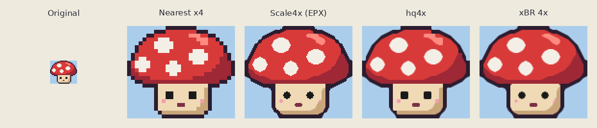
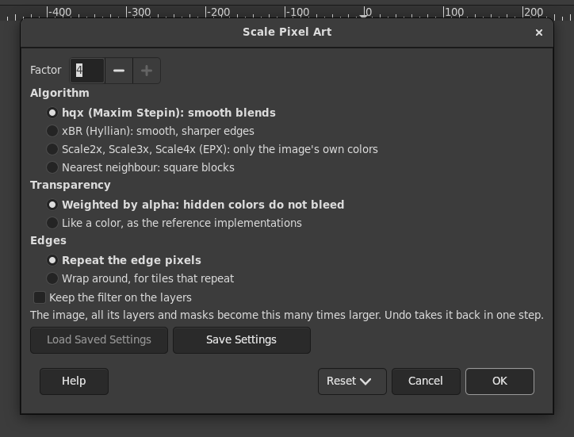
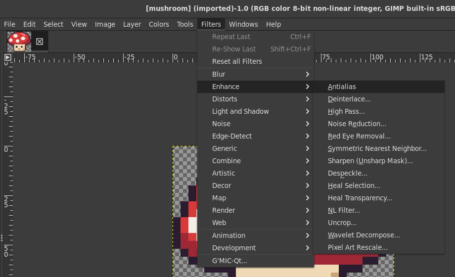
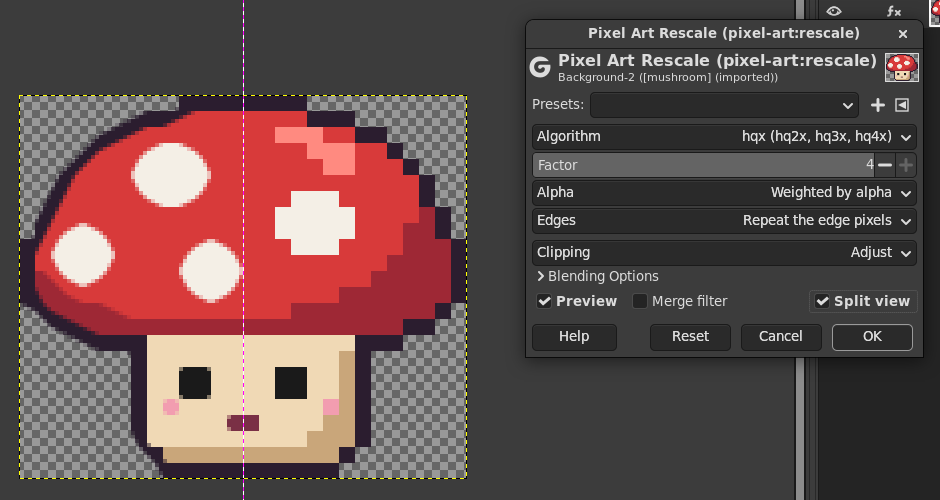
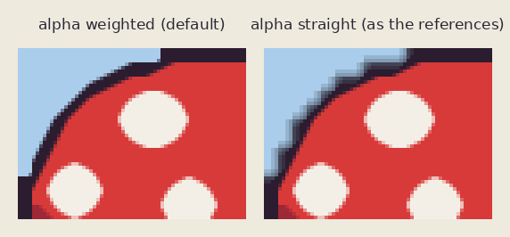

# gegl-pixel-scale

Pixel art scalers for GIMP 3: hqx (hq2x, hq3x, hq4x), xBR, Scale2x,
Scale3x, Scale4x (EPX) and nearest neighbour, as GEGL operations and a
GIMP plug-in.

- **Image > Scale Pixel Art...** scales the whole image 2, 3 or 4 times
  in one undo step: canvas, layers and their offsets, layer masks,
  channels, paths and guides.
- **Filters > Enhance > Pixel Art Rescale...** does the same to one
  layer that was scaled up with interpolation None. It works like any
  GIMP filter, non-destructively too, with preview and split view.
- For GEGL graphs and the `gegl` command line: `pixel-art:scale`, which
  makes its output 2, 3 or 4 times larger.

The results are byte for byte those of the reference implementations
(see [Tests](#tests)).

## Why

GIMP 3 has no pixel art scaler. What was checked on 2026-09-27:

- **The GIMP 2 plug-in** is [bbbbbr/gimp-plugin-pixel-art-scalers](https://github.com/bbbbbr/gimp-plugin-pixel-art-scalers),
  with 105 stars and GPL-3.0. Its last release is v1.1 (2019-12-14) and
  its last commit is from 2020-08-25. Issue #8, "GIMP 3 / GTK3
  migration", has been open since 2020-05-09. PR #9 for it was closed
  unmerged on 2021-11-19. Issue #17 (2025-12) asks for MMPX.
- **G'MIC** (stdlib version 406, and the filters it serves) has
  "Upscale [Scale2x]", which combines Scale2x and Scale3x for the
  factors 2, 3, 4, 6, 8, 9, 12, 16, 18 and 27. It also has "Xbr2x" in Testing > Garagecoder: xBR 2x without
  blending, from 2013, whose author says it "may not fully represent the
  original routine". There is no hqx, and no xBR at 3x or 4x. G'MIC
  filters are always destructive.
- **GIMP 3.2.6** lists 259 operations with `gegl --list-all` in the
  Flatpak. None of them is a pixel art scaler. `gegl:antialias` uses
  Scale3x to smooth edges but keeps the size.

## Using it in GIMP

### Image > Scale Pixel Art...

- **Factor**: 2, 3 or 4.
- **Algorithm**: see [Algorithms](#algorithms).
- **Transparency**: see [Alpha](#alpha). "Weighted by alpha" is right
  for sprites. "Like a color" gives exactly what the reference
  implementations give.
- **Edges**: repeat the edge pixels (as the references do), or wrap
  around, for tiles that repeat seamlessly (the left edge sees the right
  one, the top edge the bottom one).
- **Keep the filter on the layers**: leaves Pixel Art Rescale on each
  layer as a non-destructive filter, so you can change the algorithm
  later in the layer's effects. Without it the result is applied.

The plug-in first does what Image > Scale Image does with interpolation
None. That repeats every pixel exactly n x n times (a test checks this),
and it scales the layers with their offsets, the layer masks, channels,
paths and guides. Then it applies Pixel Art Rescale to
every layer and layer mask. It is all one undo step. Layer groups follow
their layers. The plug-in works on RGB and grayscale images; for an
indexed image, convert it to RGB first (Image > Mode).

### Filters > Enhance > Pixel Art Rescale...

GIMP applies a filter within its layer: a filter cannot make the layer or
the canvas larger. So the filter works on a layer that is already
scaled. First use Image > Scale Image with interpolation None at 200%,
300% or 400%, then open Pixel Art Rescale with the same factor. The
filter reads the middle pixel of each n x n block and redraws the layer
as the scaler would have scaled the original. It keeps the layer's size.
You get GIMP's preview, split view, blending options and non-destructive
editing, and the filter is kept in XCF files.

If you paint on the scaled layer while the filter is on, only the middle
pixel of each block counts.

## On the command line and in GEGL

    gegl sprite.png -o sprite-4x.png -- pixel-art:scale algorithm=xbr factor=4

`pixel-art:scale` has the properties `algorithm` (`hqx`, `xbr`, `scalenx`,
`nearest`), `factor` (2 to 4), `alpha` (`weighted`, `straight`) and
`edges` (`clamp`, `wrap`). Its output is the input's bounding box times
the factor: input pixel (x, y) becomes the output pixels from (n x, n y)
to (n x + n - 1, n y + n - 1). It works on any part of the output, so
GEGL can split the work between threads. `pixel-art:rescale` has the
same properties, as used in GIMP above.

GIMP does not offer `pixel-art:scale` as a filter: its category is
"transform", which GIMP hides from its filters ("Filters from category
"transform" are hidden"). The reason is the growing canvas, above. Both
operations are GPL-3.0-or-later, so GEGL offers them only to programs
that declare themselves GPL-3 (`application-license`), as GIMP and the
`gegl` command line do.

## Algorithms

- **hqx** (Maxim Stepin, 2003). It looks at the 3 x 3 pixels around each
  pixel and marks which of the 8 neighbours differ from it in YUV (by
  more than 48 in Y, 7 in U or 6 in V). From that pattern it fills the
  n x n output pixels with fixed blends of the pixel and its neighbours.
  Smooth, round shapes.
- **xBR** (Hyllian, 2011). For each corner of a pixel it weighs the color
  differences along both diagonals of a 5 x 5 neighbourhood. Where it
  finds an edge, it blends that corner of the output toward the
  neighbour across the edge, more or less far depending on how steep
  the edge is. Sharper than hqx, good at diagonals.
- **Scale2x, Scale3x, Scale4x** (EPX by Eric Johnston; AdvMAME2x/3x by
  Andrea Mazzoleni). They compare pixels for equality only and copy
  neighbours into the corners. Every output pixel is one of the input
  pixels, so there are **no new colors** (for palettes and indexed
  exports). Scale4x is Scale2x twice.
- **Nearest neighbour**: each pixel becomes an exact n x n block, for
  comparison.

All of them work on the 8-bit values of the image, as they were
designed. An 8-bit image is scaled in its own encoding, perceptual or
linear, so no value changes on the way in or out. Other precisions are
scaled as 8-bit R'G'B'A in the image's color space, so the result has
8-bit precision.

## Alpha

Pixel art usually has a transparent background, and the reference
implementations handle it badly. hqx and xBR compare only R, G and B:
a black outline and a transparent pixel (usually transparent black)
look the same to them, so the outline's outer edge is never smoothed.
They also blend alpha like a color, so the colors hidden under
transparent pixels bleed into visible ones. Scale2x compares whole
32-bit pixels, alpha included.

With **alpha weighted** (the default):

- colors are compared as they look, that is premultiplied by alpha, so
  all fully transparent pixels are the same whatever color they hide;
- hqx also counts two pixels as different when their alphas differ by
  more than 48, the same threshold as Y. Over a black or white
  background, an alpha step of 48 changes the luma you see by up to 48.
  xBR adds the alpha difference to its color distance, as the
  libxbr-standalone library does;
- blends are weighted by alpha: color = sum(w a c) / sum(w a), alpha =
  sum(w a) / sum(w). When all pixels in a blend have the same alpha, the
  reference arithmetic is used.

So opaque images give exactly the reference results in both modes. The
tests check the other properties too: a sprite on transparent pixels,
scaled and then composited over green, is within 2 of 255 of the sprite
scaled on green (the straight way is off by up to 160). Colors hidden
under transparent pixels change nothing that shows.

**Alpha straight** is the references' way, for exact compatibility.

## Building and installing

You need meson, ninja, a C compiler and the GEGL development files
(0.4.62 or newer). For a native GIMP 3:

    meson setup build -Dmoduledir=$HOME/.local/share/gegl-0.4/plug-ins \
                      -Dplugindir=$HOME/.config/GIMP/3.2/plug-ins
    ninja -C build install

For the Flatpak GIMP, build inside it with
[gimp-plugin-devtools](https://github.com/sandbranch/gimp-plugin-devtools).
It fills in the Flatpak's folders
(`~/.var/app/org.gimp.GIMP/data/gegl-0.4/plug-ins` and
`~/.config/GIMP/3.2/plug-ins`):

    gimp-build.sh . meson setup build -Dmoduledir=\$GEGL_OPDIR -Dplugindir=\$GIMP_PLUGINDIR
    gimp-build.sh . ninja -C build install

This installs `pixel-art-scale.so` and `pixel-art-rescale.so` (the GEGL
operations) and `pixel-art-scale/pixel-art-scale.py` (the plug-in).
Restart GIMP afterwards. If the operations are missing, the plug-in says
so and leaves the image as it is.

## Tests

`tests/run.sh` runs all of them. Nothing touches your own folders: GIMP,
GEGL and the builds run with a throwaway HOME and XDG folders inside the
Flatpak (`tests/isolate.sh`, from gimp-plugin-devtools). Your folders of
GIMP and other apps are listed before and after, and a test fails if
anything there changed. The test images are generated, and the sprite
was drawn for this repository.

- `tests/check.sh`: 67 checks (`tests/check.c`), built and run twice in
  the Flatpak SDK, as usual and with AddressSanitizer and UBSan (leaks
  in this code, and leaked GeglBuffers, are checked too). They cover:
  - output size and place for every algorithm and factor, down to 1 x 1,
    1 x 7 and 7 x 1, and with an offset origin;
  - Scale2x and Scale3x on a case worked out by hand from the rules at
    scale2x.it, and Scale4x = Scale2x of Scale2x;
  - exact nearest neighbour blocks, and no new colors from Scale2x/3x/4x
    and nearest (227 650 pixels each);
  - alpha: transparent stays transparent, opaque stays opaque, hidden
    colors, and the background acting like a color of its own;
  - repeated edges equal to padding with the edge pixels, wrapped edges
    equal to scaling the image tiled 3 x 3;
  - pieces at odd places, 1 and 12 threads and a second run giving the
    same bytes;
  - the regions asked for and invalidated, and a change of the input
    showing exactly there;
  - pixel-art:rescale of the nearest-scaled image equal to
    pixel-art:scale of the image (192 cases), and only the middle of
    each block counting;
  - 8-bit linear, perceptual and R~G~B~, gray and float input, and
    infinite and empty input.
- `tests/refcheck.sh`: byte for byte against the reference
  implementations, built unchanged from their sources. They are
  downloaded once by `tests/get-refs.sh` and their SHA-256 sums are
  checked:
  - Cameron Zemek's hqx library, [grom358/hqx](https://github.com/grom358/hqx)
    at commit a1c7d41 (LGPL-2.1-or-later), the usual C version of
    Stepin's code;
  - [scale2x 4.0](https://www.scale2x.it/) by Andrea Mazzoleni
    (GPL-2.0-or-later);
  - FFmpeg 8.0.1's `vf_hqx.c`, `vf_xbr.c` and `vf_epx.c`, compiled
    against a small shim of the declarations they use (`tests/ffshim`).

  The test images are 32: the sprite (also on a color, and with random
  colors hidden under its transparent pixels), checkerboards,
  diagonals, text-like glyphs (also outlined on transparent), a gradient
  with alpha, noise in few and in all colors, colors near the hqx
  thresholds, and sizes down to 1 x 1. Result: **all byte-exact** for
  hq2x/3x/4x against the hqx library (all four channels, 620 803 pixels,
  both alpha modes on the opaque images), xBR 2x/3x/4x against FFmpeg
  (R, G, B), and Scale2x/3x/4x against the scale2x library and FFmpeg's
  EPX. The YUV conversions are equal to the references' tables for all
  2^24 colors.

  FFmpeg's own hqx builds its YUV table with integer arithmetic. That
  table differs from the hqx library's for 10 426 colors, and so FFmpeg's
  results differ from the library's in 9, 13 and 35 pixels of these
  images (hq2x, hq3x, hq4x). This operation follows the hqx library.
- `tests/gimp-check.sh`: the plug-in and the filter in the Flatpak GIMP
  3.2.6, without a window, compared with the `gegl` command line byte
  for byte. It covers every algorithm and factor, a layered image (an
  offset, a group, a layer mask, a channel, a path, a guide), the filter
  route with its XCF round trip and a later change, "keep the filter",
  a grayscale image, and the plug-in without the operations installed.
- `tests/gui/gui-test.sh`: the plug-in's dialog and the filter from
  Filters > Enhance in GIMP's real dialogs on a Broadway display, driven
  by a headless Chrome. The pictures in `docs/` come from it
  (`PAS_DOCS=1`) and from `tests/make-docs.sh`.
- `tests/bench.sh`: the times below.

## Speed

On a Ryzen 9 5900X (12 cores, 24 threads), GIMP 3.2.6's Flatpak GEGL
0.4.72, GCC 15.2 at -O2: a 1024 x 1024 sprite sheet, rendered whole
into memory, best of three runs, in seconds.

| | x2 | x3 | x4 | x4, 1 thread |
|---|---|---|---|---|
| hqx | 0.015 | 0.021 | 0.042 | 0.26 |
| xBR | 0.009 | 0.017 | 0.023 | 0.12 |
| Scale2x/3x/4x | 0.004 | 0.014 | 0.024 | 0.14 |
| nearest | 0.004 | 0.013 | 0.021 | 0.11 |

At x4 the output is 16.8 megapixels. Pixel Art Rescale, as the plug-in
uses it on the sheet already scaled up, takes about the same (hqx x4:
0.036 s, 0.26 s on one thread).

## Licenses

GPL-3.0-or-later (COPYING), except as follows:

- The hqx rules in `operations/hqx.c` come from FFmpeg's `vf_hqx.c` by
  Clément Bœsch, under the ISC license, whose notice the file keeps. The
  YUV conversion there follows the hqx library (LGPL-2.1-or-later) by
  its published formulas.
- `operations/xbr.c` is a modified version of FFmpeg's `vf_xbr.c`
  (Hyllian, Arwa Arif) and stays under the LGPL-2.1-or-later.
- Scale2x/3x/4x (`operations/scalenx.c`) is written from the description
  of the algorithm at scale2x.it.

The reference sources used by the tests are downloaded into
`tests/output`, not kept in the repository. xBRZ (Zenju, GPL-3.0 only)
is not used here (see PLAN.md).
